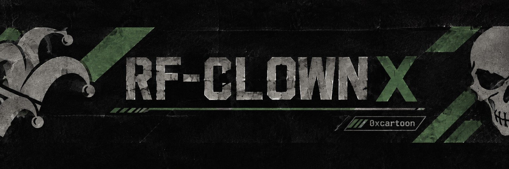

<div align="center">



ESP32 with three nRF24 radios, a 128×64 OLED and three buttons. Scanners, a spectrum view, jammers, WiFi and BLE tools, and a few protocol experiments.

[](LICENSE)
[](https://www.espressif.com/en/products/socs/esp32)
[](RFClownX/config.h)
[](https://github.com/cifertech/RF-Clown)

Fork of [RF-Clown](https://github.com/cifertech/RF-Clown) by [CiferTech](https://cifertech.net/). They designed the board and wrote the original firmware.

</div>

---

> **Before you transmit.** Jamming is illegal in most countries, and an amateur licence doesn't cover it. The tools that transmit here (jammers, beacon and clone spam, BLE spam, MouseJack, BadBLE) are for equipment you own or have written permission to test. Fines and prison sentences are real outcomes.

---

## What it does

Runs on the device. Two-level menu on the OLED, three buttons, NeoPixel for state. No app or serial console.

| Input | Action |
|-------|--------|
| Left / Right | Move through the menu |
| Select (short) | Open a category, start a tool, toggle a jammer's sweep mode |
| Select (hold) | Back or stop the tool. 500 ms by default, adjustable in System → Back Time |

NeoPixel is blue in the menu and green while a tool runs.

Menu: **Jammers**, **Scanners**, **Attacks**, **Games**, **System**.

## Tools

| Tool | Details |
|------|---------|
| WiFi scan | SSID, BSSID, channel, RSSI, encryption, with a detail screen |
| BLE scan | Name, address, RSSI, address type, manufacturer |
| AirTag scan | Find My advertisements |
| Spectrum | 126 channels from the nRF24 carrier detector, with slow decay so peaks stay readable |
| Jammers | Eight channel sets: WiFi, video, RC, BLE, Bluetooth, USB wireless, Zigbee, nRF24. Random or sequential sweep, radios tuned independently, live frequency and range bar |
| Beacon spam | Fake access points |
| Clone spam | Copies an SSID using trailing spaces |
| BLE spam | Apple Continuity and Google Fast Pair adverts |
| RC Replay | Captures nRF24 traffic and retransmits it |
| MouseJack | 2-byte promiscuous capture, filtered by a real ESB CRC check |
| BadBLE | Advertises as a Bluetooth keyboard and types a demo payload after pairing |
| System | Brightness, chip and memory info, per-radio SPI test, back-button timing, Remote AP, About |
| Extras | Snake, animated boot splash |

## Differences from RF-Clown

- Category menu with hold-to-go-back, instead of the single carousel.
- WiFi/BLE scanners, spectrum, spam tools, RC Replay, MouseJack and BadBLE.
- Remote web UI over the device's own access point.
- Jammers sweep in 1 MHz steps (channels 1–84); each radio is tuned separately.
- Radios stay powered down until a tool starts.
- Brightness and back-button timing persist in NVS.
- Left and Right have separate debounce timers, so a fast left-then-right press is no longer dropped.
- MouseJack keymap handles `-`.
- Frame counters only increment on successful transmits.

## Hardware

| Part | Detail |
|------|--------|
| MCU | ESP32-WROOM-32U, 4 MB flash |
| Radios | 3 × GT24 Mini (nRF24L01+ compatible), shared SPI bus |
| Display | 0.96" SSD1306 128×64 OLED, I²C |
| Input | 3 tactile buttons (left, right, select) |
| Indicator | WS2812 NeoPixel |
| Power | Li-ion cell, TP4056 charger, LF33 3.3 V regulator |
| Programming | CP2102 USB-UART |

### Pinout

| Function | GPIO |
|----------|------|
| Button — Left | 27 |
| Button — Right | 25 |
| Button — Select | 26 |
| NeoPixel | 14 |
| nRF24 A — CE / CSN | 5 / 17 |
| nRF24 B — CE / CSN | 16 / 4 |
| nRF24 C — CE / CSN | 15 / 2 |
| OLED | I²C defaults — SDA 21 / SCL 22 |

> Radio B's CSN is on GPIO 4, which is why the NeoPixel sits on GPIO 14.

### Photos

Upstream hardware:

| RF-Clown v1 | RF-Clown v2 |
|-------------|-------------|
|  |  |

Schematics, gerbers, BOM and pick-and-place files are in [`Schematic/`](Schematic) and [`PCB/`](PCB).

## Build and flash

The sketch links the WiFi and BLE stacks together, which doesn't fit the default 1.3 MB app partition. Use the Huge APP partition.

### Arduino CLI

```bash
arduino-cli config init
arduino-cli config add board_manager.additional_urls https://raw.githubusercontent.com/espressif/arduino-esp32/gh-pages/package_esp32_index.json
arduino-cli core update-index
arduino-cli core install esp32:esp32
arduino-cli lib install "RF24" "U8g2" "Adafruit NeoPixel"

# Compile and upload (use your own port)
arduino-cli compile --fqbn "esp32:esp32:esp32:PartitionScheme=huge_app" -u -p /dev/ttyUSB0 RFClownX
```

On Windows the port looks like `COM5`.

### Arduino IDE

1. Install the **ESP32** board package (core **3.3.x**).
2. Install **RF24**, **U8g2** and **Adafruit NeoPixel**.
3. Board: **ESP32 Dev Module**.
4. Tools → Partition Scheme → **Huge APP (3MB No OTA/1MB SPIFFS)**.
5. Open [`RFClownX/RFClownX.ino`](RFClownX/RFClownX.ino) and upload.

Upstream targeted core 1.0.x. This fork builds against 3.3.x. Architecture and code layout: [`docs/DEVELOPMENT.md`](docs/DEVELOPMENT.md).

## Precompiled binaries

[`Pre-compiled Bin/`](Pre-compiled%20Bin) has `v1.0.0.bin` and `v2.0.0.bin`. Source is v2.2.0, so build from source for the newer tools. Flash at `0x1000`:

```bash
esptool.py --chip esp32 --port /dev/ttyUSB0 write_flash 0x1000 "Pre-compiled Bin/v2.0.0.bin"
```

Or use the ESP32 Flash Download Tool: chip ESP32, baud 115200, start address `0x1000`.

## Remote WebUI

Access point `RF_CLOWN_X`, password `clownx2400`, address `192.168.4.1`, pinned to channel 1. Join it and open `http://192.168.4.1`.

`System → Remote AP` switches the access point on or off (L/R to toggle, hold to save). Stored in NVS, on by default.

The panel mirrors the screen, rebuilt from menu state at full width, with `Pixels` for the raw 128×64 frame. Virtual Left/Right/Select/Back, a launcher built from the real menu tables, a deadman timer (15 s, 45 s, 120 s or off, default 45 s), brightness and a panic stop. The timer runs on its own task, so it still fires when the link drops.

WiFi tools retune or switch off the radio, so the page disconnects while they run and reconnects when the tool exits. One radio can't hop channels and host a network at the same time. The timer and the physical buttons keep working.

Spectrum and scan results aren't in the web UI. That data is local to each tool and thrown away when it returns.

## Repository layout

| Path | Contents |
|------|----------|
| [`RFClownX/`](RFClownX) | Firmware — `RFClownX.ino`, `config.h`, `setting.h/.cpp`, `neopixel.cpp`, `webui.h/.cpp`, `webui_page.h` |
| [`docs/DEVELOPMENT.md`](docs/DEVELOPMENT.md) | Build notes, pinout, architecture |
| [`Schematic/`](Schematic) | Board schematic |
| [`PCB/`](PCB) | Gerbers, BOM, pick-and-place, renders |
| [`Pre-compiled Bin/`](Pre-compiled%20Bin) | Ready-to-flash images |
| [`Previous Versions/`](Previous%20Versions) | Original v1 firmware, older PCB and schematic |

## Credits

**Original project** — [RF-Clown](https://github.com/cifertech/RF-Clown) by [CiferTech](https://cifertech.net/). Board, PCB, enclosure and base firmware are theirs, under MIT.

**Libraries** — [RF24](https://github.com/nRF24/RF24) by TMRh20, [U8g2](https://github.com/olikraus/u8g2) by olikraus, [Adafruit NeoPixel](https://github.com/adafruit/Adafruit_NeoPixel), [Arduino core for the ESP32](https://github.com/espressif/arduino-esp32).

**Fork** — Fermin Cortell ([@fcortell](https://github.com/fcortell)).

## License

MIT. Original work © 2022 CiferTech. See [LICENSE](LICENSE).
